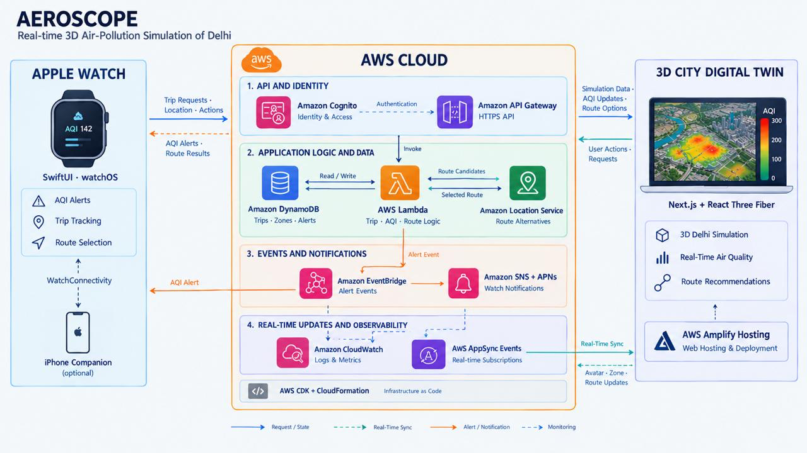

# AEROSCOPE — Delhi Air Intelligence

AEROSCOPE is an interactive air-pollution awareness platform for Delhi.

It combines a 3D digital twin of the city with an Apple Watch companion. The goal is simple: help people understand the air around them and make safer travel decisions.

## 1. What problem are we tackling?

Every day, students, employees and travellers move through Delhi. We can see traffic, construction and busy roads, but we cannot see the polluted air we are breathing.

AQI gives us a number, but a number alone does not answer practical questions such as:

- Which areas are currently more polluted?
- Is the pollution coming from traffic, construction or another source?
- Which route could reduce our exposure?
- How can we get a warning before entering a polluted area?

Air pollution can affect the lungs and heart even when its effects are not immediately noticeable. People should not have to become experts in environmental data before they can make a better travel decision.

## 2. What are we trying to do?

AEROSCOPE turns air-quality information into something people can explore and act on.

The web app shows a 3D model of Delhi with pollution zones, landmarks, roads, traffic and environmental layers. Users can select a location and quickly see its simulated AQI, PM2.5, PM10, temperature, wind and pollution sources.

The Apple Watch companion brings the same idea into a daily journey. It can warn a user about poor air ahead, track a trip and suggest a cleaner route.

In short:

> We are moving from “What is the AQI?” to “How can I use this information to make a better decision?”

## 3. How did we approach the solution?

We built the project as one shared experience with three parts.

### A. A 3D city people can understand

The simulation is a stylised digital twin of Delhi built with Next.js, React and React Three Fiber. It includes:

- Around 2,500 procedural buildings
- Roads, trees, street lights and vehicles
- Delhi landmarks such as India Gate, Red Fort, Jama Masjid, Lotus Temple and Qutub Minar
- Metro lines, trains, buses, cars, auto-rickshaws, river boats and construction sites
- Day, sunset and night lighting
- Animated traffic, clouds, pollution plumes and wind streams

The city is deliberately schematic. It is designed to make patterns easy to see rather than reproduce Delhi survey-perfectly.

### B. A transparent air-quality model

The app currently uses 17 zones across five regions and 23 representative pollution sources.

Each reading is generated from a clear, repeatable scenario model:

```text
AQI = zone baseline
    × atmosphere preset
    × time-of-day mixing
    × traffic factor
    × wind dilution
```

There are eight time steps and four atmosphere presets:

- Clear Morning
- Urban Traffic Haze
- Winter Stagnation
- Breezy Dispersal

The app uses Indian/CPCB AQI bands and PM2.5/PM10 sub-index calculations. The same readings power the map, labels, KPIs, charts, tables and pollution heatmap, so different parts of the interface do not show conflicting numbers.

### C. Alerts and cleaner routes

The watch and live dashboard can support a trip workflow:

1. Start a trip from the watch or dashboard.
2. Match the user to a Delhi zone using GPS or simulated movement.
3. Evaluate the current and upcoming zone.
4. Warn the user when poor air is ahead.
5. Compare the current route with an alternative route.
6. Let the user choose the route with lower estimated exposure.

The system also handles practical cases such as stale data, offline actions, duplicate requests, alert cooldowns and locations outside the modelled city.

## 4. What has been built?

### Web application

- `/` — landing page explaining the product and the watch journey
- `/simulation` — full-screen interactive 3D simulation
- Search for zones, landmarks, buildings and pollution sources
- Select a location and view its details in the side panel
- AQI heatmap, sources, boundaries, wind and plume layers
- Timeline controls and atmosphere presets
- Day, sunset, night and automatic lighting modes
- Responsive desktop and mobile layouts

### Apple Watch and iPhone companion

- AQI home screen with zone, PM2.5 and data-status information
- Trip start, pause, resume and end flows
- Poor-air alerts with haptics and health guidance
- Cleaner-route suggestions and route selection
- Trip exposure summary, including average and peak exposure
- Alert preferences, sensitive-group settings and look-ahead distance
- Offline action queue with later synchronization
- iPhone companion for settings, pairing and demo controls

### Backend and live mode

- User sign-in and session handling
- Trip and alert APIs
- Watch pairing
- Position evaluation and zone matching
- Route comparison
- Realtime updates and polling fallback
- Push-notification integration
- Demo and AWS-backed modes using the same core trip logic

## 5. How AWS came into the picture

The 3D city is useful on its own, but the web app and Apple Watch need a shared backend. AWS gives the project a place to store data, run the decision-making logic and connect devices.

### What each AWS service does

- **AWS Amplify Hosting / CloudFront:** Hosts and delivers the web application.
- **Amazon Cognito:** Signs users in and keeps user trip data associated with the right account.
- **Amazon API Gateway:** Provides secure HTTP endpoints for the web app, iPhone and watch.
- **AWS Lambda:** Runs the application logic for trips, AQI evaluation, alerts and route comparison.
- **Amazon DynamoDB:** Stores zones, trips, alerts, preferences, scenarios and selected routes.
- **Amazon Location Service:** Provides route candidates and geographic routing information.
- **Amazon EventBridge:** Connects important events, such as alerts and route changes, to backend workflows.
- **Amazon SNS and APNs:** Deliver pollution alerts to Apple devices when configured.
- **AWS AppSync Events:** Sends realtime trip, avatar, alert and route updates to subscribed clients.
- **Amazon CloudWatch:** Provides logs, metrics and alarms for monitoring the system.
- **AWS IAM:** Controls which services can access which resources.
- **AWS CDK and CloudFormation:** Define the infrastructure as code so it can be recreated consistently.

AWS helps us move from a local demo to a system that can support multiple users and devices. Instead of every client calculating and storing its own state, the backend can evaluate trips centrally and share the result with the web dashboard, iPhone and watch.

## 6. Architecture

The main flow is:



In plain language:

1. The watch or web dashboard sends a trip, location or route request.
2. API Gateway receives the request and Lambda runs the business logic.
3. Lambda reads and writes shared state in DynamoDB.
4. Amazon Location can provide route alternatives.
5. EventBridge forwards important events such as pollution alerts.
6. SNS/APNs can notify the watch.
7. AppSync Events can update the web dashboard in realtime.
8. CloudWatch records logs and metrics so the system can be monitored.

### Current deployment status

The repository contains the AWS infrastructure and integration code, but the AWS stacks are **prepared, not deployed or verified from this environment**. Without AWS environment variables, the web app safely uses the bundled demo dataset.

The project also includes a local watch backend for testing trips, alerts, routes and realtime events without deploying AWS.

## 7. Future scope

The next improvements are:

- Connect the product to verified live monitoring data.
- Add more Delhi zones and improve geographic accuracy.
- Complete the production realtime connection between watch events and the 3D dashboard avatar.
- Improve route recommendations with richer traffic, weather and pollution data.
- Add historical views so users can compare pollution across days and seasons.
- Add more cities after validating the Delhi experience.
- Add a watch-face complication for quick AQI access.
- Add HealthKit workout support for longer trip tracking.
- Add stronger production identity and secrets management through Cognito and AWS Secrets Manager/SSM.
- Add accessibility improvements and more language options.

## 8. Setup for someone else

### Requirements

- Node.js 22 or newer
- npm
- Xcode 26 or newer for the Apple Watch project
- AWS SAM and AWS CLI only if deploying the AWS stacks

### Run the web app

```bash
npm install
npm run dev
```

Then open [http://localhost:3000](http://localhost:3000).

Useful commands:

```bash
npm run build       # Create a production build
npm start           # Serve the production build
npm run typecheck   # Run TypeScript checks
npm run lint        # Run ESLint
npm test            # Run web tests
```

No environment variables are required for the demo. The app uses the bundled data through `/api/air-quality/zones`.

### Explore the simulation

- Mouse: drag to pan, right-drag to rotate, scroll to zoom, click to select
- Touch: one finger pans, pinch zooms and rotates, tap selects
- Keyboard: `WASD`/arrow keys pan, `Q`/`E` rotate, `+`/`-` zoom, `/` search, `Esc` deselects

### Run the local watch backend

```bash
cd watch/backend
npm install
npm run dev
```

The local backend runs at `http://localhost:8787` and uses in-memory demo data.

To run the native watch app:

1. Open `watch/AeroscopeWatch.xcodeproj` in Xcode.
2. Select the `AeroscopeWatch` scheme and an Apple Watch simulator.
3. Run the app.
4. Open Settings → Data → Demo, or choose **Try Demo**.
5. Start a trip to **Red Fort Precinct**.

The deterministic demo journey can be advanced manually or allowed to move automatically. At India Gate, it produces a poor-air warning for Connaught Place and offers a cleaner route through Yamuna Riverfront.

### Deploy the AWS backend

The AWS deployment is optional. The repository includes SAM and CDK infrastructure under `infra/` and `cloud/`.

For the basic air-quality API:

```bash
cd infra
npm install
sam validate --lint
sam build
sam deploy --guided
```

After deployment, configure the Next.js server with:

```bash
AEROSCOPE_AQ_API_URL=https://<api-id>.execute-api.<region>.amazonaws.com/prod
AEROSCOPE_AQ_API_KEY=<server-side-api-key>
```

Never expose the API key through a `NEXT_PUBLIC_` variable.

For the complete live trip, watch and realtime system, see:

- [`watch/README.md`](watch/README.md)
- [`watch/backend/README.md`](watch/backend/README.md)
- [`watch/docs/API.md`](watch/docs/API.md)

## 9. Project structure

```text
app/          Next.js pages and API routes
components/   3D world, dashboard, landing page and watch/live panels
data/         Demo zones, landmarks, regions and pollution sources
lib/          AQI logic, simulation engine, city generator and integrations
store/        Zustand state for simulation and live trip data
infra/        Basic AWS SAM stack for zones and scenarios
cloud/        Larger CDK/Lambda backend for live trips and events
watch/        Apple Watch app, iPhone companion and watch backend
types/        Shared TypeScript data types
```

## 10. Data and product limitations

- The demo readings are simulated, not official measurements.
- The city is stylised and not survey-accurate.
- The air-quality model is transparent and deterministic, but it is not a forecast or atmospheric-physics model.
- Heatmaps, plumes, haze and wind are visual explanations of the scenario, not scientific dispersion outputs.
- AWS deployment and live data connections must be configured and verified before treating the system as production-ready.
